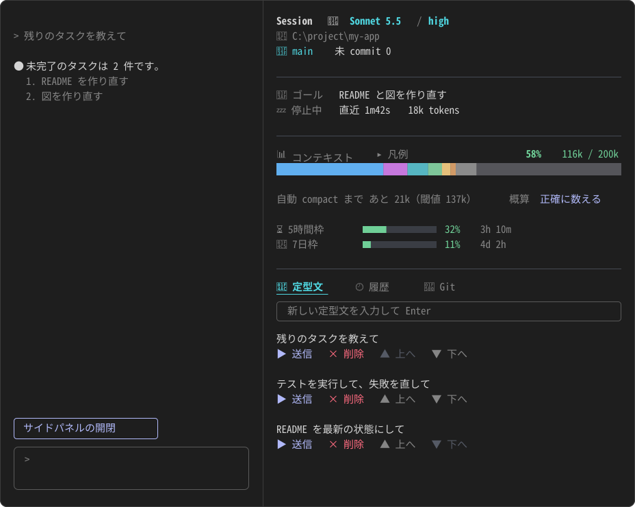
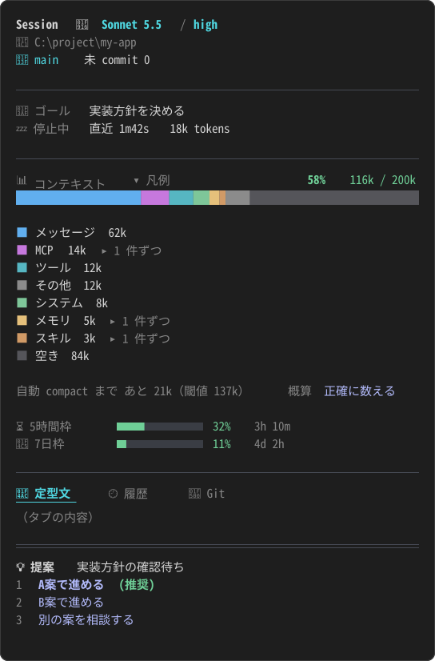
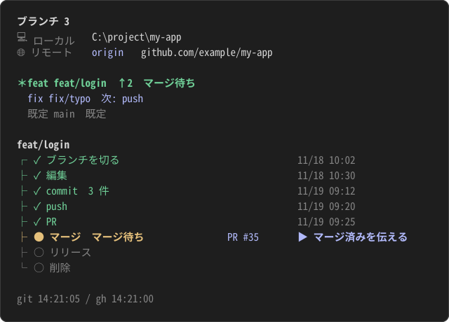

# sidekick

Claude Code の横に、サイドパネル（以下、パネル）「Sidekick」を出すプラグイン。定型文の送信、送ったプロンプトの履歴、Git ブランチの進み具合、Claude の作業状況を、パネルで見られる。Claude Code の利用者向け。

```bash
claude plugin install sidekick --marketplace asama0101/sidekick
```



## 機能

パネルは、上から、セッション帯、タブの行、タブの内容の順に並ぶ。

| 部分 | できること |
|---|---|
| セッション帯 | Claude の作業状況とブランチ名を、どのタブでも見る |
| 定型文タブ | 登録した文を、ボタン 1 つで送る。文を足す、並び替える、消す |
| 履歴タブ | 送ったプロンプトを、新しい順に見る。全文を開く、定型文に足す |
| Git タブ | ブランチの一覧と、選んだブランチの経過を見て、次の操作を、ボタンで Claude に頼む |

- 作業状況は、ゴール、実行状態、コンテキスト（Claude が会話で読み込んでいる内容）の使用量、利用枠（Claude の使用量の上限）。Claude が人の判断を待つときは、「提案」の選択肢が出る。
- 経過は、ブランチが「どこまで済んで、次に何をするか」。

- パネルは git や gh に書き込まない。書き込むのは、頼まれた Claude。
- 入力欄の上に、パネルを開閉する「サイドパネルの開閉」ボタンが出る。

## 導入方法

前提:

- Windows 11（動作を確認した OS。ほかの OS は未検証）
- Claude Code 2.1.329（動作確認したバージョン。ほかのバージョンは未検証）
- Git 2.41 以上（Git タブが使う。古いと、ブランチが多いときに「今: 判定できない」が増える）
- GitHub CLI の `gh`（任意。入っていてログイン済みなら、Git タブに PR の状態が出る）
- ゴールと「提案」は、Claude が答え終わるたびに、追加で Claude を 1 回呼んで作る。その分の利用量がかかり、止める設定はない（止めるには、アンインストールする）

冒頭のコマンドを実行する。Claude Code を新しく開始すると、パネルが開く。

端末の幅が狭いと、パネルが自動では開かないことがある。そのときは、「困ったとき」の「パネルが出ない」を見る。

### zip で導入する

GitHub のリポジトリを `git clone` できないときや、コードを確認してから入れたいときに使う。

**警告**: 展開したフォルダは、導入後も、更新と再導入の参照元として使われる。導入後に、そのフォルダを削除・移動・改名すると、更新できなくなることがある。ダウンロードフォルダやデスクトップには置かず、残しておくフォルダ（例: `$HOME\claude-plugins`）に置く。

前回の `sidekick.zip` や `sidekick-main` が残っていると、展開に失敗することがある。先に消すか、別のフォルダで実行する。

PowerShell で、次のコマンドを実行する。`sidekick-main` フォルダができる。

```powershell
New-Item -ItemType Directory -Force $HOME\claude-plugins
Set-Location $HOME\claude-plugins
Invoke-WebRequest https://github.com/asama0101/sidekick/archive/refs/heads/main.zip -OutFile sidekick.zip
Expand-Archive sidekick.zip -DestinationPath .
claude plugin install sidekick --marketplace ./sidekick-main
```

### 保存せずに試す

リポジトリを取得して、リポジトリ直下で次のコマンドを実行する。`./sidekick` がプラグインのフォルダ。そのセッションだけで有効になる。

```bash
claude --plugin-dir ./sidekick
```

### 更新する

次のコマンドを実行して、Claude Code を再起動する。

```bash
claude plugin update sidekick
```

### アンインストール

**警告**: パネルが出なくなる。戻すときは、導入方法をもう一度実行する。

```bash
claude plugin uninstall sidekick
claude plugin marketplace remove sidekick
```

zip で導入したときは、そのあとで `sidekick-main` フォルダを消してよい。戻すときは、「zip で導入する」の手順をやり直す。

## 使い方

表示例は、コードの文言から書いた。実際の見た目と少し違うことがある。

### 基本の流れ

1. Claude Code を開始する。パネルに「定型文」タブが開く。初期の定型文はなく、一覧は「なし」と出る。
2. 一覧の上の入力欄（`新しい定型文を入力して Enter`）に `残りのタスクを教えて` と入力して、Enter を押す。一覧に、次の 2 行が出る。

   ```
   残りのタスクを教えて
   ▶ 送信  × 削除  ▲ 上へ  ▼ 下へ
   ```

3. 「▶ 送信」を押す。その文が、入力欄から送ったときと同じように、Claude に送られる。
4. 「履歴」タブを押す。`N. 残りのタスクを教えて` と出る（N は、そのセッションで送った順の番号）。「＋ 定型文に追加」を押すと、その文が定型文の末尾に足される。
5. Git のリポジトリのフォルダなら、「Git」タブを押す。ブランチの一覧と、いまのブランチの経過が出る。いまのブランチが既定のブランチ（main など）のときは、経過の代わりに `経過はありません（既定ブランチ）` と出る。
6. Claude が答え終わるたびに、パネルの一番上のセッション帯で、ゴールが更新される。

### セッション帯

パネルの一番上にあり、どのタブを開いていても見える。次の図は、凡例を開いた状態と、「提案」が出た状態。



| 項目 | 見方 |
|---|---|
| 見出し | `Session` と `モデル名 / effort`（例: `Sonnet 5.5 / high`）が出る |
| ディレクトリとブランチ | 見出しの下に、ディレクトリと、🌿 ブランチ名と `未 commit N` が出る |
| 🎯 ゴール | Claude が、返答のたびに 1 行にまとめる。目的が大きく変わったときだけ書き換わる |
| 実行状態 | 実行中は `⚡ 実行中 Bash 0m42s`、停止中は `💤 停止中  直近 1m42s  18k tokens` と出る |
| 📊 コンテキスト | 使用率、使用トークン数 / 窓の大きさ（例: `116k / 200k`）、色分けしたバーが出る |
| ⏳ 5時間枠、📅 7日枠 | 使用率のバーと、使用率、リセットまでの残り時間が出る |

- effort は、Claude の考える深さの設定（low・medium・high など）。
- ディレクトリは、長いときは先頭を `…` にする。`未 commit N` の N は、未 commit の変更があるパスの数。Git のリポジトリの外では、ブランチは出ない。
- 実行中の `Bash` は、動いているツールの名前で、続くのは経過時間。止まった理由が `エラーで停止`、`拒否で停止`、`中断` のときは、停止中の行の末尾に出る。
- コンテキストとバーの色は、60% 未満が緑、60% 以上で黄、80% 以上で赤。
- 5時間枠と 7日枠は、Claude の使用量の上限を数える期間（5 時間、7 日）。色の基準はコンテキストと同じ。上限のないアカウントでは出ない。
- 値が読めない項目は出ない。

#### コンテキストの凡例

凡例（バーの色の意味）は、最初は隠れている。

- 見出しの横の `▸ 凡例` を押すと、バーの下に凡例が出る。`▾ 凡例` に変わり、押すと、また隠れる。
- 凡例は、メッセージ・MCP・ツール・システム・メモリ・スキル・その他・空きを、色と名前とトークン数で、1 行に 1 項目ずつ並べる。トークン数の多い順で、空きは最後。0 の項目は出ない。
- MCP・メモリ・スキルの行の `▸ 1 件ずつ` を押すと、1 件ずつの内訳が開く。
- 凡例が隠れていても、バーと、その下の `自動 compact（会話が長くなったとき、Claude が古い内容を要約して減らす処理）まで あと …（閾値 …）` と `概算` は出る。
- `正確に数える` を押すと、トークン数を数える Claude の API で、そのときだけ数え直す。`概算` の代わりに `正確` と出て、次に Claude が動き出すまで残る。

### 提案（停止後の選択肢）

Claude の返答が人の判断を求めているとき（質問、案の選択、確認待ち）、タブの内容の下に、二重線で区切って「提案」が出る。短い理由と、番号つきの最大 4 行。

```
💡 提案  実装方針の確認待ち
1  A案で進める (推奨)
2  B案で進める
3  別の案を相談する
```

- ボタンを押すと、その文が、そのまま Claude に送られる。確認は挟まない。送った文は「履歴」にも載る。
- Claude が勧める案は、文が太字になり、末尾に緑で `(推奨)` と出る。勧める案がないときは、印は出ない。
- Claude が動いている間と、エラー・拒否・中断で止まったときは、出ない。

### 定型文

- 入力欄に文を入力して Enter を押すと、一覧の末尾に足される。空の文と、すでにある文は足されない。
- 操作は、どの行も「▶ 送信」「× 削除」「▲ 上へ」「▼ 下へ」の順に並ぶ。先頭の「▲ 上へ」は押せない薄い字で出る。末尾の「▼ 下へ」も同じ。
- 「▶ 送信」と「× 削除」は、確認なしで、すぐに実行する。
- 6 件以上あるときは、先頭の 5 件だけが出る。`▾ もっと見る（あと N 件）` で残りが開き、`▴ 閉じる` で戻る。
- 定型文と並び順は、次のセッションにも残る。パスワードなどの秘密を書いたプロンプトは、追加しない。
- 消した文は、同じセッションの中で送ったことのある文なら、履歴の「＋ 定型文に追加」で足し直せる。

### 履歴

- 番号は送信順で、新しいプロンプトが上に並ぶ。6 件以上あるときは、新しい 5 件だけが出る。`▾ もっと見る（あと N 件）` で古いものまで開く。
- プロンプトは、60 字までに短くして並ぶ。「▾ 全文」を押すと、その 1 件が全文になり、「▴ 短く」で戻る。全文を開けるのは、同時に 1 件だけ。
- 記録するのは、入力欄から送ったプロンプト、Remote Control（スマートフォンや Web の接続先）から送ったプロンプト、パネルのボタンで送ったプロンプトの 3 つ。
- 履歴は保存先に書かないので、新しく開始したセッションには残らない。

### Git タブ

Claude Code を開いているフォルダのリポジトリ 1 つを見る。見出しの下に、ローカルのフォルダとリモート、ブランチの一覧が並ぶ。



- 一覧の行頭の `＊` は、いまチェックアウトしているブランチ。続けて、種類が出る。種類は、ブランチ名の接頭辞（`feat/` `fix/` `docs/` `chore/`）で決まり、ほかの名前は `その他`、既定のブランチは `既定`。
- 6 つ以上あるときは、先頭の 5 つだけが出る。`▾ もっと見る（あと N 件）` で残りが開く。いまのブランチと、選んだブランチは、5 つの外にあっても出る。
- 行を押すと、そのブランチの経過が出る。経過は、「ブランチを切る → 編集 → commit → push → PR → マージ → リリース → 削除」の 8 段階。
- `↑2 ↓1` が付くのは、origin に同名のブランチがあって、差があるとき。`↑` は origin にまだない commit の数（push が必要）、`↓` は origin だけにある commit の数。
- リモートは、名前と URL が 1 行ずつ出る。ホスト名のある URL は、クリックできるリンクになる。認証情報（`user:token@`）は出さない。push・PR・差の判定に使うのは、名前が `origin` のリモートだけ。
- 一番下の行は、git と gh を最後に読んだ時刻（例: `git 14:21:05 / gh 14:21:00`）。

#### 経過の見方

各段階は、縦の線（`┌` `├` `└`）でつながる。日時は右端に出る。日時が取れない段階は、`—` と出る。

| 記号 | 意味 | 色 |
|---|---|---|
| `✓` | 済（日時つき） | 緑 |
| `●` | 今（次に取りかかる段階） | 黄色・太字 |
| `○` | これから | 灰色 |
| `?` | 取れなかった | 赤 |
| `－` | 省略または対象外 | 灰色 |

一覧の右端の「今」の一覧、次へ進むボタン、リリースの選択、黄色い文、更新のタイミングは、[docs/git-tab.md](docs/git-tab.md) に書いた。いまチェックアウトしているブランチが次の段階に進めるときは、その段階の行に `▶ commit する` などのボタンが出る。押すと、確認なしで、その依頼が Claude に送られる。

**警告**: `▶ ブランチを削除` は、未 push の commit を失うことがある。戻し方は、[docs/git-tab.md](docs/git-tab.md) の「次へ進むボタン」に書いた。

## 困ったとき

### パネルが出ない

端末の幅が狭いと、パネルが自動では開かないことがある（目安は 144 列未満。実機では未確認）。端末の幅を広げるか、入力欄の上の「サイドパネルの開閉」ボタンを押す。

アンケートの表示中は、ボタンが出ない。アンケートに答えるか閉じると、ボタンが出る。

画面に出るエラーの文言ごとの原因と対処は、[docs/troubleshooting.md](docs/troubleshooting.md) に書いた。

## ライセンス

MIT License。商用利用、改変、再配布ができる。コピーには、著作権表示と [LICENSE](LICENSE) の全文を付ける。
